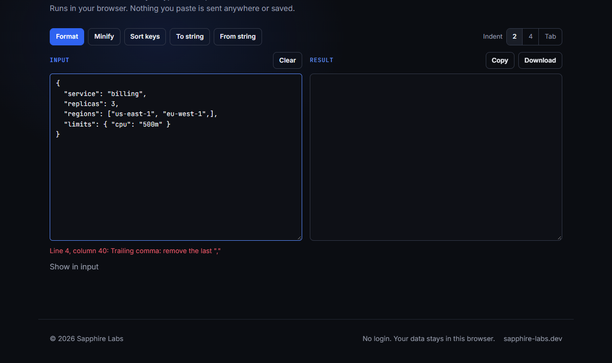
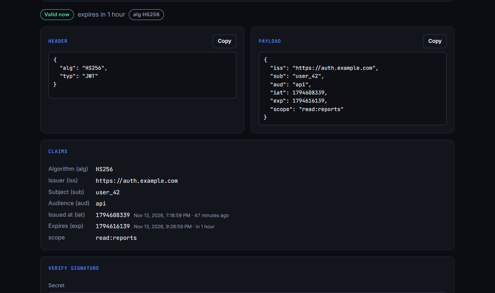
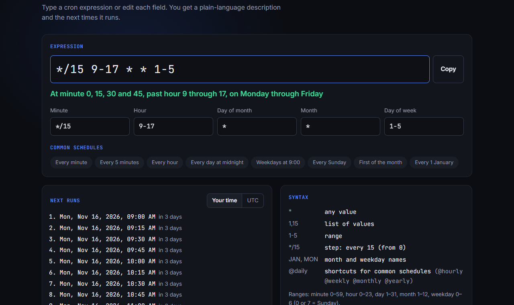
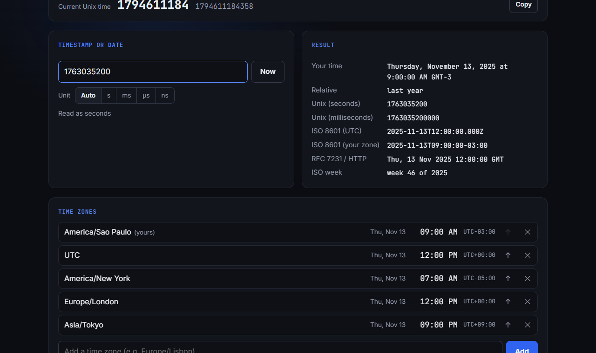

# Coding Helpers

[](https://github.com/sapphire-labs-dev/coding-helpers/actions/workflows/ci.yml)
[](LICENSE)

Small developer tools that run entirely in your browser: **JSON toolkit**, **cron builder**, **UUID tools**, **JWT inspector** and **timestamp / time-zone converter**.

**Nothing you paste ever leaves your browser.** Tokens, JSON and keys are never sent anywhere and never saved; the page cannot even make requests to other sites (see [Security](#security)).

**Use it:** https://dev.sapphire-labs.dev · English and Portuguese · dark, light and pink themes

| JSON toolkit | JWT inspector |
|---|---|
|  |  |
| **Cron builder** | **Timestamp converter** |
|  |  |

## Why

Pasting a production token or a customer's JSON into a random website is a real risk. These tools give the same answers without sending your data anywhere, open instantly, and have no ads or accounts.

## Tools

**JSON toolkit** (`/json`)
- Validates as you type and points to the **exact line and column** of a problem with a clear message (trailing comma, single quotes, unclosed string…); "show in input" selects it.
- Warns about **duplicate keys** (which `JSON.parse` silently drops).
- Format (2 / 4 spaces or tab), minify, sort keys deeply, turn text into a JSON string literal and back. Copy or download the result.

**Cron builder** (`/cron`)
- Standard 5-field expressions with lists, ranges, steps, month and weekday names, and `@daily`-style shortcuts.
- Plain-language description in English or Portuguese; edit the expression or each field.
- The **next 10 runs** in your time zone or UTC. Follows the classic rule that a day matches when *either* day-of-month or day-of-week matches if both are set.

**UUID tools** (`/uuid`)
- Generate up to 1,000 **v4** (random) or **v7** (time-ordered, sortable) UUIDs with the browser's cryptographic random generator; upper case, hyphens, braces.
- Inspect any UUID: canonical form, version, variant, and the creation time stored in v1, v6 and v7.

**JWT inspector** (`/jwt`)
- Decodes header and payload, explains registered claims, shows `iat` / `nbf` / `exp` as dates and whether the token is valid now.
- **Verifies signatures** with Web Crypto: HS256/384/512 (text or base64 secret), RS*, PS* and ES* with a PEM public key or a JWK, and EdDSA where the browser supports it. Flags unsigned (`alg: none`) tokens.

**Timestamp converter** (`/time`)
- Reads Unix timestamps in seconds, milliseconds, microseconds or nanoseconds (detected from the size, or forced) and dates in ISO 8601 and other common formats.
- Shows Unix seconds and milliseconds, ISO 8601 in UTC and in your zone, the HTTP date format, relative time and ISO week.
- Keeps a list of the time zones you work with, and a meeting planner that converts a date and time in one zone to all of them.

## Security

- Everything runs in the page. The Content-Security-Policy (`connect-src 'self'`) stops the page from sending data to any other site, and there are no analytics, fonts or scripts from third parties.
- Inputs (JSON, tokens, secrets, keys) are kept only in the page while it is open: nothing is written to `localStorage`. Only preferences are saved (indent, cron time zone, UUID options, your list of time zones).
- The JSON validator refuses absurdly deep nesting and keeps `"__proto__"` as a plain key.

See [SECURITY.md](SECURITY.md) to report a vulnerability.

## Development

Requires **Node.js 22.23 or newer** (24 LTS recommended; see `.nvmrc`).

The layout, themes, shared components and browser helpers come from [`@sapphirelabs/ui`](https://github.com/sapphire-labs-dev/sapphire-ui). Until that package is published on npm, clone it next to this repository:

```
sapphirelabs/
  coding-helpers/    ← this repository
  sapphire-ui/       ← git clone https://github.com/sapphire-labs-dev/sapphire-ui.git
```

```bash
npm install
npm run dev      # http://localhost:4321
npm run check    # type-check (also fails if a Portuguese translation is missing)
npm test         # unit tests (Vitest)
npm run build    # static site in dist/
```

Each tool lives in `src/features/<tool>/`: a pure module with its logic and tests (`json.ts`, `cron.ts`, `uuid.ts`, `jwt.ts`, `time.ts`) and a `page.ts` that wires the page. Pages are in `src/pages/`, strings in `src/i18n/` (one file per tool, English and Portuguese).

## Contributing

Issues and pull requests are welcome. Before opening a PR, run `npm run check && npm test && npm run build` (CI runs the same). New tools must work without a server and must not store what the user pastes. User-facing text needs both an English and a Portuguese string. Changes to the layout, themes or shared components belong in `@sapphirelabs/ui`.

## Deploy

It is a static site: import the repository into Vercel (Astro preset) or any static host and serve `dist/`. On hosts other than Vercel, set the headers from `vercel.json` yourself. If you use another domain, change `site` in `astro.config.mjs`.

## License and brand

The code is released under the [MIT License](LICENSE). The **Sapphire Labs** name and logo (shipped in `@sapphirelabs/ui`) are not covered by the license. If you publish a fork, please replace them and the links to sapphire-labs.dev with your own.
